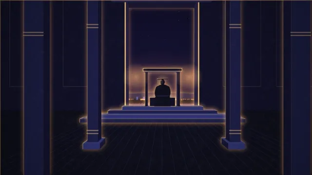
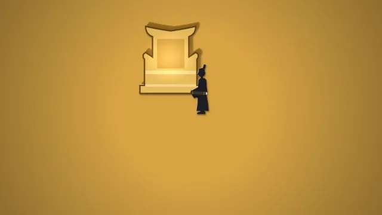
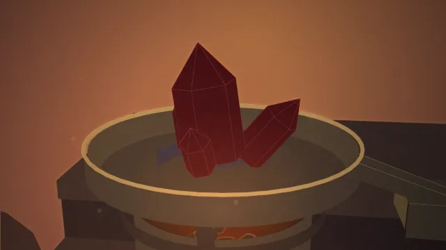
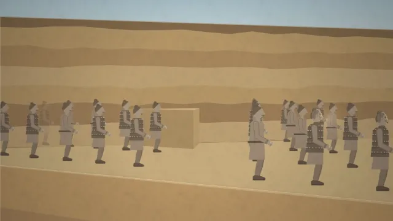

# Nomolos 03 · Qin Shi Huang: the animation

  
  
  
  

<h3 align="center"><a href="https://raisulsohan.github.io/Nomolos_03_Qin_Shi_Huang_animation/">▶ Watch the whole film (11:34) in your browser</a></h3>

Click a clip to open its scene.

  <strong>An animated documentary film conceived, illustrated, animated in Adobe After Effects, and sound-composed by <a href="https://raisulsohan.com">Raisul Sohan</a></strong>

---

## Production & Craft

*The Emperor Who Drank Mercury to Live Forever* is the third animated documentary in the **Nomolos** series, conceived, written, illustrated, animated, and sound-designed entirely by **[Raisul Sohan](https://raisulsohan.com)**. Spanning 16 complete scenes, 43 continuous sequences, and 11 minutes 34 seconds, the film unrolls the tragic, psychological, and historical paradox of China's First Emperor: how his desperate quest to conquer death ended up killing him at 49 and crumbling his empire in four years.

### 1. Adobe After Effects Animation & Compositing
The entire film was animated and composited inside **Adobe After Effects**. Across all 16 scenes and 43 sequences, complex multiplane spatial scenes were choreographed using virtual 3D camera rigs, graph editor velocity easing, and bespoke character pacing. No pre-made third-party animation templates were used—every transition, camera swoop, and sequence is handcrafted.

### 2. Handcrafted Vector Illustrations
Every single visual asset was illustrated from scratch: the grand imperial halls of Xianyang, the brutal warring states battlefields, assassination attempts with daggers hidden in rolled maps, mysterious sea expeditions sailing east, subterranean terracotta pits, and ancient alchemical furnace setups. Each composition was designed in modular, layered vector parts to allow multi-dimensional animation rigging.

### 3. Special 3D Parallax Vibe & Spatial Depth
By separating scenes into dozens of depth planes in After Effects 3D space, the film delivers a captivating **parallax effect**. As the virtual camera dollies, cranes, and pans, foreground silhouettes drift past at realistic optical speeds while midground focal subjects and expansive backgrounds shift with genuine depth of field and perspective shifts.

### 4. Atmospheric Signature Glow & Volumetric Lighting
Dramatic chiaroscuro contrasts and signature glows accentuate pivotal narrative moments—from the glowing drops of metallic mercury and lantern-lit imperial chambers to moonlit ocean waves and fiery terracotta furnaces. Layered light falloffs, lens blooms, and stylized film grain elevate the documentary feel.

### 5. Curated Sound Design & Original Audio Scoring
Created with zero budget for commercial production libraries, the complete soundscape was curated and constructed from free and public domain audio archives. Raisul Sohan discovered, cleaned, edited, and layered hundreds of sound effects (**SFX**)—drawn swords, fluttering bamboo scrolls, dripping mercury, clattering wagons, galloping horses—and composed evocative background music (**BGM / Underscores**) synchronized frame-by-frame with each visual cut.

> **Note:** All 16 scenes of the animated documentary (11:34) are complete and final.

---

## Watch

**Online: https://raisulsohan.github.io/Nomolos_03_Qin_Shi_Huang_animation/**. Play the whole film or any completed scene, in 16:9 widescreen or 4:5 mobile.

Offline, open `index.html` or any scene in a browser. No server is needed.

- `preview/` holds the whole film (`Nomolos_03_Qin_Shi_Huang_film_Desktop.html`, `Nomolos_03_Qin_Shi_Huang_film_Mobile.html`, 11:34) and the film scene by scene:
  `Nomolos_03_Qin_Shi_Huang_scene-NN_Desktop.html` (16:9, 1920×1080) and `Nomolos_03_Qin_Shi_Huang_scene-NN_Mobile.html` (4:5, 1080×1350).
- `sequences/seq-NN/` holds the individual sequences each scene is made of: `film.html` (16:9) and `film-4x5.html` (4:5).

Player keys: <kbd>Space</kbd> play/pause, <kbd>←</kbd>/<kbd>→</kbd> one frame, <kbd>Shift</kbd>+<kbd>←</kbd>/<kbd>→</kbd> one second, <kbd>Home</kbd> back to the start, <kbd>F</kbd> fullscreen.

---

## Completed Scenes

| Scene | Name | Time | Status |
|---|---|---|---|
| Scene 01 | The most powerful man, terrified | 0:00.0–0:34.7 | **FINAL** |
| Scene 02 | Ordering eternity | 0:34.7–1:10.5 | **FINAL** |
| Scene 03 | From Ying Zheng to the First Emperor | 1:10.5–2:02.1 | **FINAL** |
| Scene 04 | Building forever | 2:02.1–2:33.6 | **FINAL** |
| Scene 05 | The dagger in the map | 2:33.6–3:29.1 | **FINAL** |
| Scene 06 | The last enemy | 3:29.1–4:01.0 | **FINAL** |
| Scene 07 | Xu Fu sails east | 4:01.0–4:52.2 | **FINAL** |
| Scene 08 | Cinnabar | 4:52.2–5:25.8 | **FINAL** |
| Scene 09 | The poison that feeds the fear | 5:25.8–6:07.1 | **FINAL** |
| Scene 10 | The scholars, and the source | 6:07.1–6:53.1 | **FINAL** |
| Scene 11 | The last tour | 6:53.1–7:43.5 | **FINAL** |
| Scene 12 | The fish wagon and the forged edict | 7:43.5–8:38.4 | **FINAL** |
| Scene 13 | The reversal: body and mind | 8:38.4–9:22.1 | **FINAL** |
| Scene 14 | The reversal: the empire | 9:22.1–9:50.4 | **FINAL** |
| Scene 15 | The immortality he got | 9:50.4–10:43.6 | **FINAL** |
| Scene 16 | The trap scales up | 10:43.6–11:34.4 | **FINAL** |

---

## Author & Credits

- **Creator, Director, Screenwriter & Lead Animator:** [Raisul Sohan](https://raisulsohan.com) ([@raisulsohan](https://github.com/raisulsohan))
- **Art Direction & Vector Illustration:** Hand-illustrated by Raisul Sohan
- **Motion Animation & Compositing:** Crafted in Adobe After Effects by Raisul Sohan
- **Sound Design, SFX, BGM & Audio Scoring:** Curated, edited, and composed by Raisul Sohan from free audio archives
- **Production:** Nomolos Documentaries (Episode 03 · Qin Shi Huang)

## License

The fonts are Noto Sans and Poppins, © The Noto Project Authors and Indian Type Foundry, under the SIL Open Font License 1.1 (`fonts/OFL.txt`).
